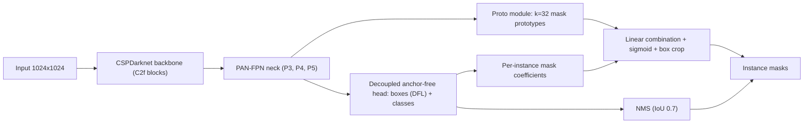
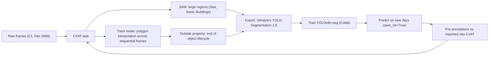

# horus-coastal-segmentation

### HORUS — Coastal Zone Analysis via Instance Segmentation on Cartagena Beaches

> **Undergraduate Research Project** · Computer Vision · Instance Segmentation · Coastal Monitoring
>
> YOLOv8-seg instance segmentation of Cartagena beaches for occupancy analysis (umbrellas, awnings, crowds) on 2009 coastal camera imagery, with CVAT + SAM annotation and a roadmap toward shoreline erosion monitoring.

<p align="left">
  
  
  
  
</p>

---

## Table of Contents

1. [Abstract](#1-abstract)
2. [Repository Structure](#2-repository-structure)
3. [Dataset & Challenges](#3-dataset--challenges)
4. [Model Architecture (YOLOv8-seg)](#4-model-architecture-yolov8-seg)
5. [Annotation Pipeline (CVAT & SAM)](#5-annotation-pipeline-cvat--sam)
6. [Installation](#6-installation)
7. [Training & Inference Usage](#7-training--inference-usage)
8. [Results](#8-results)
9. [Limitations](#9-limitations)
10. [Future Work](#10-future-work)

---

## 1. Abstract

**HORUS** is an undergraduate research project that applies computer vision to the analysis of coastal zones on the beaches of Cartagena, Colombia. The system performs **object detection, instance segmentation and tracking** of semantically relevant elements in the beach scene — most notably **umbrellas (*sombrillas*)** and **awnings/tents (*toldos*)** — as a proxy for measuring **beach occupancy levels** over time.

The pipeline is built on a **one-stage instance segmentation** model (**YOLOv8n-seg**, via `ultralytics`) trained on a historical archive of fixed-camera imagery from 2009. Ground truth was produced in **CVAT**, accelerated by the **Segment Anything Model (SAM)** and temporal polygon interpolation (Track mode). The resulting model (`best.pt`) jointly segments **8 classes** covering both landscape (sea, sand, buildings, groyne, palm trees) and occupancy-related objects (umbrellas, awnings, crowds).

Beyond occupancy estimation, the architecture is designed as the foundation for a **long-term environmental monitoring** objective: segmenting the **shoreline (`linea_costera`)** to quantify **coastal erosion** across time.

---

## 2. Repository Structure

```text
horus-coastal-segmentation/
├── Proyecto_Horus_YoloV8_Seg.ipynb          # Main notebook: training, inference, FFmpeg video pipeline,
│                                            # per-class filtered visualizations (masks / no boxes / no labels)
├── Modelo_Pre_Etiquetado.ipynb              # Model-assisted pre-labeling notebook (train → predict save_txt
│                                            # → export YOLO polygons to re-import into CVAT)
│
├── dataset_cartagena/                       # Training dataset (Ultralytics YOLO Segmentation 1.0)
│   ├── data.yaml                            # 8-class dataset definition
│   ├── images/train/                        # 80 frames (1024×768), Camera 1, Dec 4–5 2009
│   └── labels/train/                        # Polygon labels: <cls> x1 y1 x2 y2 ... (normalized)
│
├── Etiquetas/
│   └── Ultralytics_C1_12_Dia_4_y_5/         # Raw CVAT export (YOLO Segmentation 1.0)
│       ├── data.yaml
│       └── labels/train/
│
├── Imágenes/                                # Raw image archive (Camera 1, December 2009)
│   ├── C1_12_Dia_04_y_05/                   # Frames used for training / video synthesis
│   ├── C1_12_Dia_06/  (Parte 1, Parte 2)    # Unseen frames used for pre-labeling inference
│   └── Videos/video_salida_04_05.mp4        # Frame sequence encoded with FFmpeg (H.264)
│
├── Modelo_Para_Pre_Etiquetar/
│   ├── Resultados/Entrenamiento_1_C1_12_Dia_04_y_05/
│   │   ├── args.yaml                        # Full training hyperparameters
│   │   ├── results.csv                      # Per-epoch losses and box/mask metrics
│   │   └── weights/{best.pt, last.pt}       # Trained YOLOv8n-seg checkpoints (~6.8 MB)
│   └── Etiquetas_Obtenidas/                 # Predicted labels on Day 06 (pre-annotations for CVAT)
│       ├── Etiquetas_C1_12_06/              # obj.names / obj.data / labels
│       └── labels_folder*/
│
├── Entrenamiento_1_C1_12_Dia_04_y_05-.../   # Mirror of the training run downloaded from Drive
│
└── Videos_Resultado/                        # Rendered inference videos (.avi)
    ├── 04_05_Salida_Sin_Modificar.avi       # All classes, boxes + masks + labels
    ├── video_paisaje_04_05.avi              # Landscape classes only  [0,1,2,3,7]
    ├── video_salida_objetos_04_05.avi       # Occupancy objects only  [4,5]
    ├── 04_05_Sombrillas.avi / 04_05_Toldos.avi
    ├── *_sin_texto.avi                      # Masks + boxes, no labels/confidence
    └── *_sin_bdgb.avi                       # Masks only (no bounding boxes)
```

---

## 3. Dataset & Challenges

### 3.1 Source

| Property | Value |
|---|---|
| Location | Beaches of Cartagena de Indias, Colombia |
| Capture period | December 2009 |
| Sensor | Fixed coastal camera — **Camera 1 (C1)** |
| Resolution | **1024 × 768** px |
| Training subset | **80 images** (Dec 4–5, `C1_12_Dia_04_y_05`) |
| Inference / pre-label subset | Dec 6 (`C1_12_Dia_06`) |
| Label format | Ultralytics YOLO Segmentation 1.0 (normalized polygons) |

### 3.2 Class taxonomy

| ID | Class (`data.yaml`) | English | Group |
|---:|---|---|---|
| 0 | `Mar` | Sea | Landscape |
| 1 | `Arena` | Sand | Landscape |
| 2 | `Edificios` | Buildings | Landscape |
| 3 | `Espigon` | Groyne / jetty | Landscape |
| 4 | `Sombrilla` | Umbrella | Occupancy |
| 5 | `Toldo` | Awning / tent | Occupancy |
| 6 | `Multitud_Personas` | Crowd of people | Occupancy |
| 7 | `Palmera` | Palm tree | Landscape |

The taxonomy mixes **amorphous "stuff" regions** (sea, sand) with **countable "things"** (umbrellas, awnings), effectively turning the task into a panoptic-like problem solved under an instance segmentation formulation.

### 3.3 Computer vision challenges

- **Severe occlusion.** At peak hours umbrellas and awnings overlap heavily, both mutually and with crowds. Instance boundaries become ambiguous, which particularly penalizes mask quality (mAP50-95(M)) relative to box quality.
- **High instance density.** Dozens of small, near-identical instances per frame stress NMS (`iou=0.7`, `max_det=300`) and favor high input resolution (`imgsz=1024`).
- **Sub-optimal compression.** 2009-era JPEG artifacts (blocking, chroma bleeding) degrade fine edges — critical for thin structures (palm fronds, groyne edges, shoreline).
- **Illumination drift.** Sun angle changes across the day (hard shadows, specular glare on water, low-contrast dusk frames) produce strong intra-class appearance variance; partially mitigated by HSV augmentation (`hsv_h=0.015, hsv_s=0.7, hsv_v=0.4`).
- **Low resolution & small objects.** Distant umbrellas occupy only a few pixels; the stride-8 P3 head of YOLOv8 is the main contributor to their detection.
- **Data scarcity.** Only 80 annotated frames — mitigated by COCO-pretrained weights, mosaic augmentation, and a model-assisted labeling loop (see §5).

---

## 4. Model Architecture (YOLOv8-seg)

### 4.1 Why one-stage?

| Criterion | YOLOv8-seg (one-stage) | Mask R-CNN (two-stage) |
|---|---|---|
| Inference speed | Real-time, single forward pass | RPN + RoIAlign + mask head; significantly slower |
| Parameter count (nano) | ~3.4 M | ~44 M (R50-FPN) |
| Iteration speed | Train 100 epochs in ~30 min on Colab GPU | Considerably longer cycles |
| Tooling | `ultralytics` CLI/API, native CVAT export format | Detectron2 / MMDetection setup |
| Mask resolution | Prototype-based, full-image masks | 28×28 RoI masks upsampled |

YOLOv8-seg was selected for its **speed, competitive accuracy and suitability for rapid iterative prototyping**, a key requirement given the model-in-the-loop annotation strategy.

### 4.2 Architecture overview



- **Backbone / Neck:** CSPDarknet with C2f blocks and a PAN-FPN neck producing multi-scale features at strides 8/16/32.
- **Head:** anchor-free, decoupled classification/regression branches; box regression via **Distribution Focal Loss (DFL)**; label assignment via **Task-Aligned Assigner**.
- **Mask branch (YOLACT-style):** a Proto module generates 32 prototype masks; each detection predicts 32 coefficients that are linearly combined, passed through a sigmoid and cropped by its bounding box.
- **Loss:** `L = λ_box·L_CIoU + λ_cls·L_BCE + λ_dfl·L_DFL + L_seg`, with `box=7.5`, `cls=0.5`, `dfl=1.5`, `overlap_mask=True`, `mask_ratio=4`.

### 4.3 Training configuration (from `args.yaml`)

| Hyperparameter | Value | Hyperparameter | Value |
|---|---|---|---|
| Base weights | `yolov8n-seg.pt` (COCO) | Epochs | **100** |
| `imgsz` | **1024** | Batch | 16 |
| Optimizer | `auto` (SGD/AdamW) | `lr0` / `lrf` | 0.01 / 0.01 |
| Momentum / WD | 0.937 / 5e-4 | Warmup epochs | 3 |
| Mosaic / `close_mosaic` | 1.0 / 10 | `fliplr` | 0.5 |
| `scale` / `translate` | 0.5 / 0.1 | `erasing` | 0.4 |
| AMP | ✅ | Seed / deterministic | 0 / ✅ |

---

## 5. Annotation Pipeline (CVAT & SAM)



1. **Foundation-model assisted labeling.** SAM (integrated in CVAT) produces high-quality polygons for large, irregular regions (`Mar`, `Arena`, `Edificios`) from a handful of clicks.
2. **Temporal tracking.** Because frames come from a fixed camera in temporal sequence, **Track mode** interpolates polygons between keyframes, drastically reducing per-frame effort for static or slow-changing objects.
3. **Object lifecycle.** Umbrellas/awnings that are removed or leave the field of view are terminated with the **`Outside`** property, avoiding phantom interpolated masks.
4. **Export.** Labels are exported as **Ultralytics YOLO Segmentation 1.0** (`<class> x1 y1 … xn yn`, normalized to `[0,1]`).
5. **Model-assisted pre-labeling (active loop).** `Modelo_Pre_Etiquetado.ipynb` uses the trained `best.pt` to infer polygons on unseen days (`C1_12_Dia_06`) and exports them (`Modelo_Para_Pre_Etiquetar/Etiquetas_Obtenidas/`) for human correction in CVAT, closing a human-in-the-loop data engine.

---

## 6. Installation

### Local environment

```bash
# Clone the repository
git clone https://github.com/<your-username>/horus-coastal-segmentation.git
cd horus-coastal-segmentation

# Create an isolated environment
python -m venv .venv
# Linux/macOS
source .venv/bin/activate
# Windows (PowerShell)
.venv\Scripts\Activate.ps1

# Core dependencies (pulls torch, torchvision, opencv-python, etc.)
pip install ultralytics pyyaml

# Optional: GPU build of PyTorch (example for CUDA 12.1)
pip install torch torchvision --index-url https://download.pytorch.org/whl/cu121
```

**FFmpeg** is required for frame-to-video encoding:

```bash
# Ubuntu / Colab
sudo apt-get install -y ffmpeg
# Windows
winget install Gyan.FFmpeg
# macOS
brew install ffmpeg
```

### Google Colab (as used in this research)

```python
from google.colab import drive
drive.mount('/content/drive')

!pip install ultralytics
!unzip "/content/drive/MyDrive/<path>/dataset_cartagena.zip" -d "/content/"
```

---

## 7. Training & Inference Usage

### 7.1 Dataset configuration

```python
import yaml

config = {
    "train": "/content/dataset_cartagena/images/train",
    "val":   "/content/dataset_cartagena/images/train",  # see §9: no held-out split yet
    "nc": 8,
    "names": ["Mar", "Arena", "Edificios", "Espigon",
              "Sombrilla", "Toldo", "Multitud_Personas", "Palmera"],
}

with open("/content/dataset_cartagena/data.yaml", "w") as f:
    yaml.dump(config, f)
```

### 7.2 Training

```bash
# Fine-tune COCO-pretrained YOLOv8n-seg for 100 epochs at 1024 px
yolo task=segment mode=train \
     model=yolov8n-seg.pt \
     data=/content/dataset_cartagena/data.yaml \
     epochs=100 imgsz=1024 \
     name="Entrenamiento_1_C1_12_Dia_04_y_05"
```

Equivalent Python API:

```python
from ultralytics import YOLO

model = YOLO("yolov8n-seg.pt")
model.train(data="dataset_cartagena/data.yaml", epochs=100, imgsz=1024,
            name="Entrenamiento_1_C1_12_Dia_04_y_05")
```

### 7.3 Pre-labeling inference (export polygons for CVAT)

```python
from ultralytics import YOLO

model = YOLO("Modelo_Para_Pre_Etiquetar/Resultados/Entrenamiento_1_C1_12_Dia_04_y_05/weights/best.pt")

results = model.predict(
    source="Imágenes/C1_12_Dia_06/Parte 2",
    save_txt=True,   # writes YOLO-seg polygons to runs/segment/predict/labels
    conf=0.5,        # confidence threshold
    imgsz=1240,      # rounded internally to a multiple of 32 (1248)
)
```

```python
# Package labels for re-import into CVAT
import shutil
shutil.make_archive("labels_folder", "zip", "runs/segment/predict/labels")
```

### 7.4 Video inference with FFmpeg

The archive consists of still frames; they are first encoded into an H.264 sequence (1 frame/s) to enable temporal visualization:

```bash
ffmpeg -framerate 1 -pattern_type glob \
       -i "Imágenes/C1_12_Dia_04_y_05/*.jpg" \
       -c:v libx264 -pix_fmt yuv420p video_salida.mp4
```

> On Windows, `-pattern_type glob` is not supported; use a numbered pattern (`-i frame_%04d.jpg`) or a concat list.

```bash
BEST=Modelo_Para_Pre_Etiquetar/Resultados/Entrenamiento_1_C1_12_Dia_04_y_05/weights/best.pt

# All 8 classes (boxes + masks + labels)
yolo task=segment mode=predict model=$BEST source=video_salida.mp4 save=True

# Landscape-only: Sea, Sand, Buildings, Groyne, Palm
yolo task=segment mode=predict model=$BEST source=video_salida.mp4 save=True \
     classes=[0,1,2,3,7] name=prediccion_paisaje

# Occupancy objects only: Umbrella + Awning
yolo task=segment mode=predict model=$BEST source=video_salida.mp4 save=True \
     classes=[4,5] name=prediccion_objetos

# Umbrellas only, clean masks (no labels, no confidence, no bounding boxes)
yolo task=segment mode=predict model=$BEST source=video_salida.mp4 save=True \
     classes=4 name=prediccion_sombrillas_sin_bdgb \
     show_labels=False show_conf=False show_boxes=False
```

### 7.5 Tracking & occupancy counting (Python)

The training config already references `tracker: botsort.yaml`; persistent IDs allow occupancy curves per class:

```python
from ultralytics import YOLO

model = YOLO("Modelo_Para_Pre_Etiquetar/Resultados/Entrenamiento_1_C1_12_Dia_04_y_05/weights/best.pt")

for t, r in enumerate(model.track(source="video_salida.mp4", classes=[4, 5],
                                  tracker="botsort.yaml", persist=True, stream=True)):
    cls = r.boxes.cls.int().tolist()
    print(f"frame={t} umbrellas={cls.count(4)} awnings={cls.count(5)}")
```

---

## 8. Results

Final metrics of `Entrenamiento_1_C1_12_Dia_04_y_05` (epoch 100, from `results.csv`, ~31 min total training time):

| Metric | Box (B) | Mask (M) |
|---|---:|---:|
| Precision | 0.976 | 0.934 |
| Recall | 0.975 | 0.932 |
| mAP@0.5 | **0.985** | **0.925** |
| mAP@0.5:0.95 | 0.847 | 0.694 |

| Loss (final) | Train | Val |
|---|---:|---:|
| box | 0.934 | 0.874 |
| seg | 1.429 | 1.288 |
| cls | 0.625 | 0.530 |
| dfl | 0.844 | 0.823 |

**Observations**

- The ~15-point gap between box mAP50-95 and mask mAP50-95 reflects the difficulty of producing tight masks under **occlusion** and compression artifacts, where a correct box does not imply a pixel-accurate mask.
- Qualitative results on unseen frames (`C1_12_Dia_06`) and rendered videos in `Videos_Resultado/` show stable segmentation of landscape classes and consistent detection of umbrellas/awnings across the day.

---

## 9. Limitations

> [!WARNING]
> In the current run the **validation split equals the training split** (`val: images/train`). The metrics above therefore measure **fit**, not generalization, and should be read as an upper bound. A temporally disjoint split (e.g., train on Dec 4–5, validate on Dec 6) is the immediate next step.

- Small dataset (80 frames, single camera, two days) → risk of overfitting to a specific viewpoint and lighting regime.
- No per-class AP breakdown reported yet; crowded classes (`Sombrilla`, `Multitud_Personas`) are expected to underperform aggregate figures.
- `yolov8n` is the smallest variant; `s`/`m` backbones may improve mask quality on occluded instances.
- In the notebook, run names `prediccion_sombrillas` use `classes=5` (`Toldo`); class IDs, not run names, are authoritative.

---

## 10. Future Work

- **Shoreline segmentation (`linea_costera`).** Add a new class modeling the land–water interface, enabling the extraction of a shoreline polyline per frame.
- **Coastal erosion measurement.** Track the shoreline position over multi-year imagery, apply camera rectification (homography / ground control points) to convert pixel displacement into metric shoreline retreat, and derive erosion-rate indicators aligned with the project's environmental-monitoring objectives.
- **Rigorous evaluation.** Held-out temporal/day splits, per-class AP, k-fold cross-validation given the small dataset.
- **Occlusion-aware improvements.** Larger backbones (`yolov8s/m-seg`, YOLO11-seg), higher-resolution masks (`retina_masks=True`), copy-paste augmentation, and SAHI-style tiled inference for small, dense instances.
- **Temporal occupancy analytics.** BoT-SORT/ByteTrack-based counting to produce hourly occupancy curves and heatmaps.
- **Data engine scaling.** Extend the CVAT + SAM + model-assisted pre-labeling loop to additional cameras, months and years of the archive.

---

### Acknowledgments

Developed as part of an **Undergraduate Research** initiative on computer vision for coastal monitoring in Cartagena, Colombia. Built with [Ultralytics YOLOv8](https://github.com/ultralytics/ultralytics), [CVAT](https://www.cvat.ai/) and [Segment Anything](https://segment-anything.com/).
